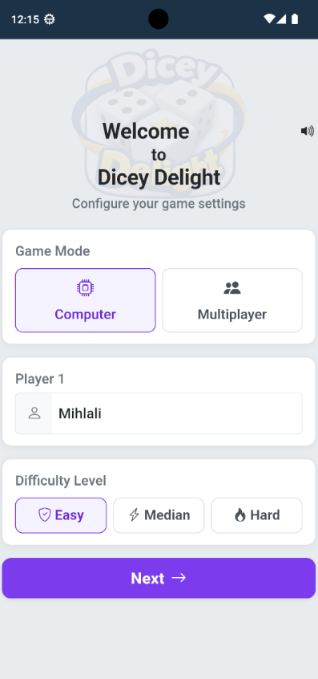
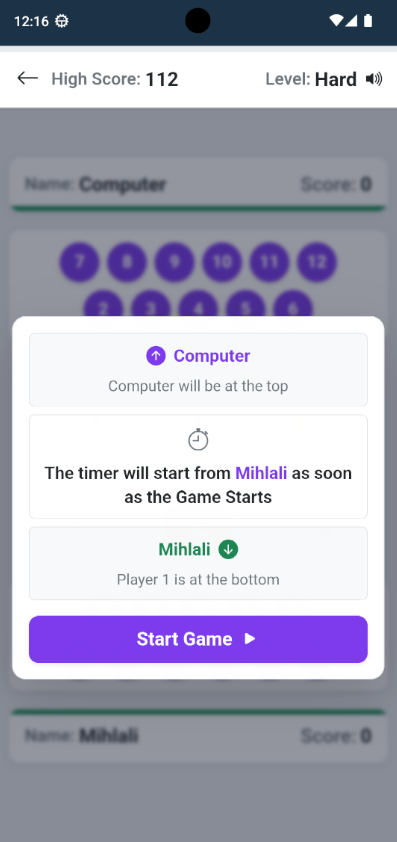
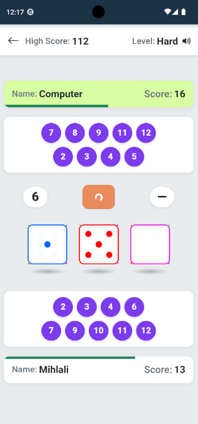
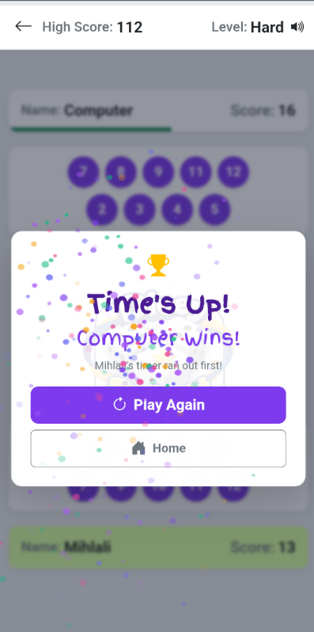

# Dicey Delight

A fast, fun, and modern two-player dice board game built with **.NET MAUI** and **Blazor Hybrid**. Play solo against the computer or challenge a friend in local pass-and-play multiplayer mode.

---

## Built With

[](https://dotnet.microsoft.com/en-us/apps/maui)
[](https://dotnet.microsoft.com/en-us/apps/aspnet/web-apps/blazor)
[](https://learn.microsoft.com/en-us/dotnet/csharp/)
[](https://dotnet.microsoft.com/)
[](https://developer.mozilla.org/en-US/docs/Web/HTML)
[](https://developer.mozilla.org/en-US/docs/Web/CSS)
[](https://developer.mozilla.org/en-US/docs/Web/JavaScript)
[](https://getbootstrap.com/)

---

## Features

- **Two Game Modes**: Play solo against the Computer or against a friend in local Multiplayer.
- **Three Difficulty Levels**:
  - **Easy**: 120 seconds per player
  - **Median**: 60 seconds per player
  - **Hard**: 30 seconds per player
- **Interactive 3D Dice**: Animated 3D dice rolling with realistic physics.
- **Star Steal Mechanic**: Roll a star on the third die to steal your opponent's highest cleared number.
- **Sound Effects**: Custom audio with Web Audio API and quick mute/unmute toggle.
- **Score Tracking**: Live scores, persistent high score, and winner celebration fireworks.
- **Cross-Platform**: Runs on Android, Windows, iOS, and macOS.

---

## Quick Start

### 1. Prerequisites

- [.NET 10 SDK](https://dotnet.microsoft.com/)
- Visual Studio 2022+ (with MAUI workload) or VS Code

### 2. Clone and Run

```bash
git clone https://github.com/username/DiceyDelight.git
cd DiceyDelight
dotnet restore
```

To run on Windows:

```bash
dotnet build -t:Run -f net10.0-windows10.0.19041.0
```

To run on Android:

```bash
dotnet build -t:Run -f net10.0-android
```

For full instructions, see [DOCS/SETUP.md](DOCS/SETUP.md).

---

## How to Play

1. Enter your name and choose **Single Player** (vs Computer) or **Multiplayer**.
2. Select your difficulty level (Easy, Median, or Hard).
3. On your turn, tap the **Roll** button.
4. The sum of the first two dice removes that number box (2 to 12) from your board.
5. If the third die rolls a **Star (★)**, you steal your opponent's highest cleared number!
6. First player to clear all 11 numbers—or whose opponent runs out of time—wins the game!

For detailed rules and strategies, read [HOW_TO_PLAY.md](HOW_TO_PLAY.md).

---

## Screenshots

|                           Home Page                            |                         Ready to Play                          |                        Gameplay Screen                        |                         Game Results                          |
|:--------------------------------------------------------------:|:--------------------------------------------------------------:|:-------------------------------------------------------------:|:-------------------------------------------------------------:|
|       |  |  |  |

---

Developed with passion by students from the University of Fort Hare.
